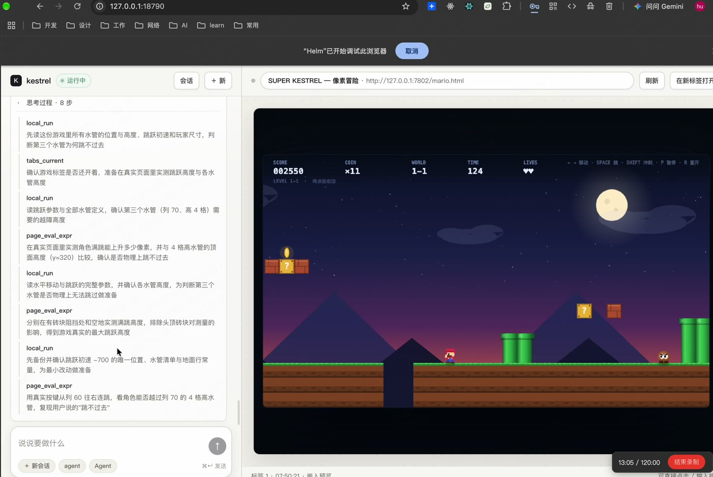

# Kestrel

一个常驻的 Bun 进程，内含 **agent 循环**（模型请求 → 工具批次执行 → 结果回灌）和 **浏览器执行端**（Playwright 驱动本机 Google Chrome）。前端是一个单文件 HTML 页面：左边对话，右边 iframe 里嵌着它正在操作的那个标签页。

- 进程：`bun run service/server.ts`，`Bun.serve` 监听 `127.0.0.1:18790`（`KESTREL_PORT` 可覆盖）
- 前端：`public/index.html`，单文件，无框架、无构建步骤
- 执行端：`service/browser/host.ts`，`playwright-core` 复用本机已安装的 Chrome，持久化 profile
- 内核（loop、上下文/记忆/压缩、工具注册与校验、provider 适配）来自作者的另一个扩展形态项目 tChrome；本项目替换的是浏览器执行层，工具 schema 与语义保持一致

[](docs/demo-small.mp4)

录屏 2 分 01 秒，2748×1840。原始录制 37 分 51 秒，成片把静止画面加速、操作画面保留细节后压到 3 倍速。`docs/demo-small.mp4`（4.7MB，GitHub 页面内直接播放）／`docs/demo-3x.mp4`（19MB，原尺寸高清）。

---

## 目录

- [代码结构与职责](#代码结构与职责)
- [一次 turn 的完整链路](#一次-turn-的完整链路)
- [上下文窗口怎么拼](#上下文窗口怎么拼)
- [压缩与摘要折叠](#压缩与摘要折叠)
- [工具系统](#工具系统)
- [浏览器执行端](#浏览器执行端)
- [右栏预览](#右栏预览)
- [数据落盘](#数据落盘)
- [Provider 适配](#provider-适配)
- [配置项](#配置项)
- [未实现与已知限制](#未实现与已知限制)

---

## 代码结构与职责

```
public/index.html            整个前端（对话 + iframe 预览 + 会话面板）
service/server.ts            Bun.serve：路由、来源校验、静态托管、SSE
service/runtime/             loop、账本、工具校验与执行、压缩调度、执行状态机、任务
service/context/             上下文模块（modules.json 唯一顺序源）、窗口组装与预算读数
service/tools/               187 份工具定义 + registry + schema 校验 + execute 分派
service/browser/             ★ 执行端：Playwright 驱动真实 Chrome
service/provider/            多网关适配（uuapi / gemini / openai / responses）+ 重试 + 解析
service/memory/              会话记忆 / 项目长期记忆 / 记忆预算
service/context-archive/     历史归档、摘要存储与分层折叠
service/agents/              Compression Agent、Query Agent（两个子模型）
service/images/              工具截图落盘与 /images/ 读取
service/stream/              WebSocket 事件管道（pull / push 会话）
service/presentation/        纯函数：把账本投影成前端消息、错误文案、列表预览
shared/                      前后端共享类型与常量
```

服务端只有一层壳：`server.ts` 把请求分派给 runtime，runtime 调 provider 拿模型输出、调 tools 执行，执行端通过唯一的 `BrowserHost` 抽象落到 Playwright。

---

## 一次 turn 的完整链路

**1. 请求**

`POST /turn { conversationId?, userInput, submittedAt }` → `runTurnWithContinuation` → `handleTurn`。分配 `turnId`，写 `turns/tn_NN.json`（字段：`input / assembled / actions / stopReason / usage`）。

`/turn` 是**同步**的：这个 HTTP 请求要等整轮结束才返回。等待期间前端每 **900ms** 轮询 `GET /session`，拿投影后的消息、工具记录和运行状态；`status` 不再是 `running` 就停止轮询。所以「边跑边看」靠轮询投影，而不是靠流式推送。

**2. 每轮模型请求之前**

```
组装 System + User 窗口 → 量字符 → 到 compressAt 就先压缩 → provider.complete()
```

`windowChars = system.length + user.length`，与 `ledger.compressAt` 比较（`loop.ts` 里 `if (initialChars >= ledger.compressAt)`）。压缩由主模型请求前的自动路径或 `agent_compress` 工具的手动路径触发，两条路径都发 `compress-start` / `compress-progress` / `compress` 事件。

**3. 模型返回工具调用**

```
checkToolCalls(raw.toolCalls, tools, baseToolsIds, toolIds, mutexGroups)
  → 参数校验、互斥组、批内编排（serial 独占 / parallel 可并发）
  → executeTool() 逐个执行
```

每次调用与结果追加到 `toolio/toolio.jsonl`；单次返回超过内联门禁的原样落盘到 `returns/call_NN.txt`，窗口里只留块索引与指针。

**4. 结果回灌，回到 2**

循环持续到：模型给出最终答复（`finishTurn`）、提出问题（`askUser`）、用户 `POST /stop`、或连续无效提交达到 `MAX_SUBMIT = 3`。

循环保护（`service/config/runtime.json` 的固定门禁）：只读调用在 30 / 60 次给提示、66 次中断；重复调用检测窗口 8 次，同一调用超过 2 次即判重复。

**5. 事件与右栏**

- `appendEvent` 追加到 `events.jsonl`（压缩、工具、记忆、状态变更等），滚动归档成 `events.NN.jsonl`
- `GET /stream` 是 WebSocket 升级路由，接到 `stream/pipe.ts` 的 hub（pull / push 会话、按文件分片推送）；网页前端不依赖它
- 右栏走独立的 `GET /api/preview/stream`（SSE），只负责「现在该显示哪个标签页」，见[右栏预览](#右栏预览)

---

## 上下文窗口怎么拼

`service/context/modules.json` 是唯一顺序源：每个模块声明 `id / role / order / file / consumers / description`，正文是 `context/system/*.md` 或 `context/user/*.md` 里的 XML 片段。

**System 侧 12 个模块**：`overview`、`identity`、`environment`、`runtimeProtocol`、`execution`、`boundaries`、`toolProtocol`、`output`、`resultEnvelope`、`contextBudget`、`baseTools`、`systemSkill`。System 承载规则，各模块的 purpose 段说明自己负责哪类行为。

**User 侧槽位**按 `context/window.ts` 组装，顺序固定：

```
#skill → #projectMemory → #tools → #conversation → #contextUsage
```

- `#conversation` 装 loop 序列：每个 loop 是一次主模型请求，含 `runtime` 输入（userInput / interrupt / callsResult / notice）与 `helm` 响应；工具调用用 `callId` 关联调用与结果
- `#contextUsage` 每渲染一次回填 `chars / compressAt / used`，供模型判断预算
- `#tools` 只放本会话已加载工具的导航（名字 + 用途首句），完整 schema 随 `tools[]` 下发；`#skill` 是技能正文，不参与压缩

---

## 压缩与摘要折叠

阈值由 `service/config/runtime.json` 的 `scale.contextWindowChars = 250000` 派生（`service/config/runtime.ts` 启动时解析并校验）：

| 门禁 | 派生方式 | 实际值 |
|---|---|---|
| `contextWindowChars` | 基准 | 250000 |
| `compressAtChars` | ×1.0 | 250000 |
| `hardLimitChars` | ×1.25（必须大于 compressAt，否则启动即报错） | 312500 |
| `inlineChars` | ×0.024，上限 6000 | 6000 |
| `intentMaxChars` | ×0.02，上限 4000 | 4000 |
| `memoryBudgetChars` | compressAt ×0.04 | 10000 |
| `pointerShellReserve` | inline ×0.1，上限 400 | 400 |
| `imageInlineBytes` | 固定 | 262144 |

**压缩规则**

- 最近 `keepLoops = 1` 个 loop 保留原文，其余按 `userInput` / `interrupt` 分区顺序处理；没有输入分界时按条数分前后两半
- 单批最多 `compressionBatchMaxLoops = 20` 个 loop；loop 不拆、不递归
- 每批摘要全部合法才覆盖对应原文，任何一批失败就停止后续批次并保留原文
- 摘要按 `loopIds` 记来源，按层折叠：行数门槛 L1→L6 为 30 / 20 / 15 / 10 / 10 / 10，每次折叠 `chunk = 10` 条，最高 `foldMaxLevel = 6`；没有新来源不单独重压已有摘要
- 压缩完仍超过 `hardLimitChars`，本轮以 `context_limit` 失败，不再通过裁剪继续缩

**记忆预算**：会话记忆每次请求都注入、不随历史压缩退出；项目记忆跨会话。注入渲染超过 `memoryBudgetChars = 10000` 时，Runtime 在窗口里加提示，要求用 `memory_delete` 删记录或设 `expiresWhen` 过期，避免只增不减。

---

## 工具系统

**定义**：`service/tools/definitions/*.json`，共 **187** 份，OpenAI function 形态——`type: "function"` + `function.name/description/parameters`，`parameters` 是 JSON Schema（多数 `additionalProperties: false`，多传字段直接判参数错误），另带一个 `execution: "serial" | "parallel"` 决定同批调度。

**分组**：`capabilities/categories.json` 与 `definitions/groups.json` 按功能归 **15 组**（页面观察与定位、页面交互、等待与断言、标签与窗口、截图与导出、存储与身份、网络与诊断、设备与指纹、验证码、表单附件、本地文件、代码工程、进程与脚本、网络请求、记忆技能会话）。`registry.ts` 读取定义与分组，生成 System `<baseTools>` 和 User `<tools>` 的导航文本，完整参数说明只走 `tools[]`，不重复进窗口。

**常驻与动态**：`coreToolIds` 恒定可用；`dynamicToolIds` 要 `catalog_add` 按需加载，加载状态在会话内保持。

**校验与执行入口**

| 环节 | 实现 |
|---|---|
| 参数 schema、互斥组、批内编排 | `tools/schema.ts` → `checkToolCalls` |
| 分派与特殊工具（task_*、agent_query、delegate_subagent 等） | `tools/execute.ts` → `executeTool` / `dispatchTool` |
| 风险门禁 | `runtime/task-gate.ts` → `requiresActiveTask(fixedRisk, modelRisk)` |

风险门禁只卡 high：固定 high 或模型自报 `risk: "high"` 的调用，必须先有活动 Task（`ledger.activeTaskId` 指向的 Task 且 `status === "active"`），否则返回 `task_gate_required`。low / medium 不受限制。

**结果门禁**：单次返回超过 `inlineChars = 6000` 就外置——原文落 `returns/call_NN.txt`，窗口里给块目录（块 ID、字符数、来源位置、检索提示），后续用 `evidence_search` 按 `blockId` 或 `keyword` 取回特定块；取回预算 = `inlineChars − pointerShellReserve`。截图等图片超过 `imageInlineBytes` 时只保留路径与缩略图。

---

## 浏览器执行端

`service/browser/host.ts`（863 行）实现 `BrowserHost`，是唯一被替换掉的层。

**启动**：`createPlaywrightHost(dataDir)` → `launchPersistentContext(<dataDir>/chrome-profile, { channel: "chrome", headless: false })`。复用系统已装的 Chrome，不额外下载浏览器；profile 持久化，登录态保留在同一份用户数据里。

**元素编号**：页面内 `window.__kestrel` 注册表分配 `e_NN` 编号，跨调用稳定；点击时取元素 rect，再用 `page.mouse.click` 按 CSS 像素落点。元素/区域编号绑定真实节点，导航后需重新定位。

**复合工具**建立在原子工具之上，不改语义：

| 复合 | 依赖的原子工具 |
|---|---|
| `page_click_role` / `page_click_text` | `page_get_by_role` / `find_on_page` → `page_click` |
| `page_fill_role` / `page_fill_submit` | `page_type` |
| `page_select_role` | `combo_select` |
| `page_submit_wait` | 先建网络监听，再点击 → `wait_response` |

**契约**：`execute(name, args) → BrowserResult`；`readCurrentTabs()` 返回 `{ ok, windows: [{ windowId, focused, tabs: [{ tabId, url, title, active }] }] }`；未实现的名字显式返回 `tool_not_implemented`，不假装成功。

**host 必须单调**：`forScope` 返回同一个 host 实例。同一份 profile 再 `launchPersistentContext` 会撞 Chrome 单例，第二个实例立刻报 `browser has been closed`。

---

## 右栏预览

右栏不是截图流，是嵌入的页面本身。

```
执行端 watchPreview(listener)  只跟踪「当前该显示哪个标签页」
        │  目标变化时 emit target
        ▼
GET /api/preview/stream (SSE)  先发 hello，之后 target / empty / error
        ▼
前端拿到 target → 设 iframe.src（原生点击、输入、滚动、游戏按键都由浏览器处理）
```

- 目标页在变化时才重新 attach，不会反复重建
- 嵌入前服务端探一次响应头（`X-Frame-Options` / CSP `frame-ancestors`，4 秒超时、结果缓存 5 分钟），结论随 `target` 下发
- 允许 → 直接 iframe 嵌入；禁止 → 显示禁止原因，并给「在新标签打开」，不静默降级成截图
- `Bun.serve` 必须设 `idleTimeout: 0`：默认 10 秒会掐断帧间静默的 SSE，`EventSource` 于是反复重连

---

## 数据落盘

数据目录：`KESTREL_DATA`，默认 `~/Library/Application Support/Kestrel`。

```
session.json            当前会话指针
conversation-id.json    会话 ID 高水位（删除后不复用）
id-counters.json        各类记录编号（page_ / call_ / img_ / task_ …）
conversations/cv_NN/
  ledger.json           会话业务状态：消息、任务、压缩阈值快照
  events.jsonl          追加事件日志（超限滚动成 events.NN.jsonl）
  toolio/toolio.jsonl   工具调用与结果（滚动成 toolio.NN.jsonl）
  turns/tn_NN.json      单轮记录：input / assembled / actions / stopReason / usage
  returns/              外置的大结果 call_NN.txt + call_NN.index.json 块索引
  images/               工具截图（img_NN）
  compression/ context-records/ agent-logs/ assets.json
chrome-profile/         Playwright 使用的 Chrome profile
provider-requests/      模型请求快照
process-output/         本地进程产物
scripts/                一次性脚本与可复用脚本
tmp/
```

`turns/tn_NN.json` 里的 `usage` 统计本轮真正发出的模型请求次数与进入执行器的工具调用次数（批量调用逐个计）。

截图不塞进消息正文：工具返回 `data:image/...;base64` 后由 `service/images/` 落盘成 `img_NN`，前端用 `GET /images/{conversationId}/{imageId}` 取原始字节。

---

## Provider 适配

`service/provider/config.ts` 是一张表，每行登记：`id / label / 默认 model / baseURL / apiKeyEnv / modelEnv / baseUrlEnv / effortEnv / kind / sanitizeToolNames`。运行时按 `KESTREL_PROVIDER` 选行，读对应的 `*_API_KEY`、`*_BASE_URL`、`*_MODEL`、`*_REASONING_EFFORT`。

表中 18 行，`kind` 决定用哪个实现：`uuapi`、`gemini`、`openai`（OpenAI 兼容）、`responses`（Responses API）。部分网关需要 `sanitizeToolNames`；`opencode*` 系列额外带固定 UA 与 `x-opencode-session` 头。

传输层的重试与超时集中在 provider 层（`runtime.json` 的 `network.maxAttempts = 10`、`retryDelayMs = 200`、`idleTimeoutMs = 90000`），业务校验、工具加载策略、批次执行都在 runtime，不在 provider。默认发 `reasoning_effort: "high"`，是否被上游采纳取决于网关与模型。

---

## 配置项

全部 `KESTREL_*` 变量（代码里实际读取的就这几个）：

| 变量 | 默认 | 作用 |
|---|---|---|
| `KESTREL_PORT` | `18790` | 监听端口 |
| `KESTREL_DATA` | `~/Library/Application Support/Kestrel` | 数据目录 |
| `KESTREL_PROVIDER` | `uuapi` | 选 provider 表里的哪一行 |
| `KESTREL_PROXY_MODE` | 未设 | 显式设 `proxy` 才启用代理 |
| `KESTREL_EXTENSION_ORIGIN` | 未设 | 额外放行的扩展来源 |

另有 `TCHROME_*` 同名回退，以及每个网关自己的 `*_API_KEY` / `*_BASE_URL` / `*_MODEL` / `*_REASONING_EFFORT`（清单见 `service/.env.example`）。

**来源校验**：路由执行前要求 Host ∈ {`127.0.0.1`, `localhost`, `[::1]`}，Origin 为 `null`、同源、`chrome-extension://<32 位>` 或等于 `KESTREL_EXTENSION_ORIGIN`，否则 `403 forbidden origin`；只放行 `GET /`、`GET /index.html` 与 `/widget/` 作为页面请求。

**可调门禁**：`service/config/runtime.json` 的 `scale.contextWindowChars` 改动会按比例重算全部派生门禁，`gates` 里的固定项（折叠行数、keepLoops、循环保护等）可单独改。

启动：

```bash
bun install
cp service/.env.example service/.env   # 填一家 provider 的 key
bun run start                          # → http://127.0.0.1:18790/
bun run typecheck                      # tsc --noEmit
```

---

## 未实现与已知限制

- `see_zoom` / `set_zoom` / `emulate_device` 三个工具在执行端仍返回 `tool_not_implemented`
- `executeTracked` 返回空 id，按 id 中止单个工具实际无效；会话级 `POST /stop` 可用（会 `host.abort(conversationId)`）
- `/health` 里保留着从 tChrome 继承的 `extension.status = "unknown"`、`actualVersion` 为 `null` 等字段，不参与任何逻辑
- 并发多会话没有做隔离验证，按单用户、单进程使用
- `service/README.md` 是内核的原始文档，部分描述仍指向扩展形态与旧端口 18789，以本文件为准
